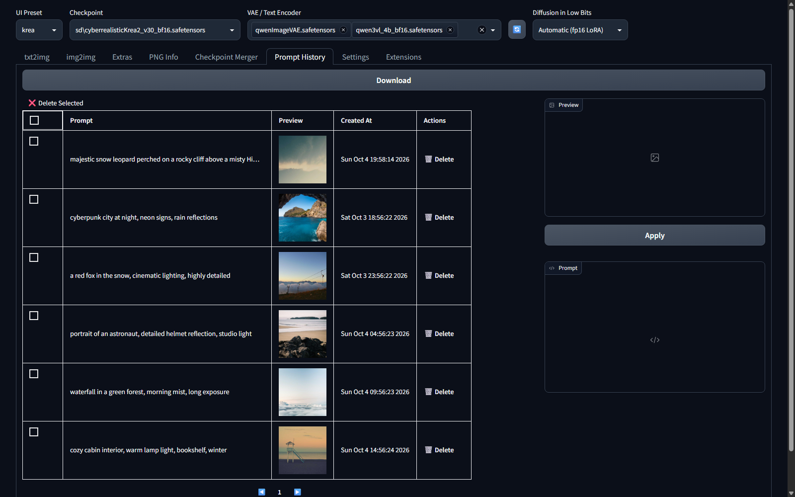
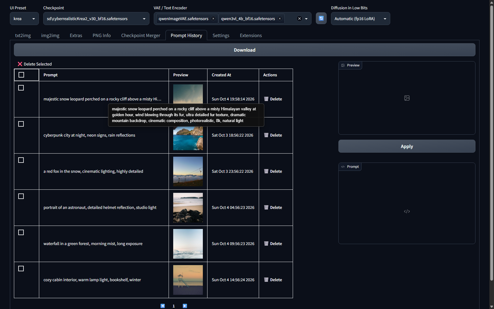
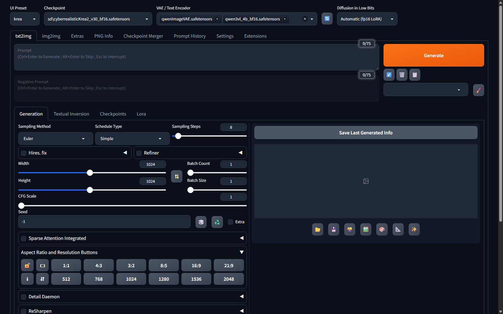
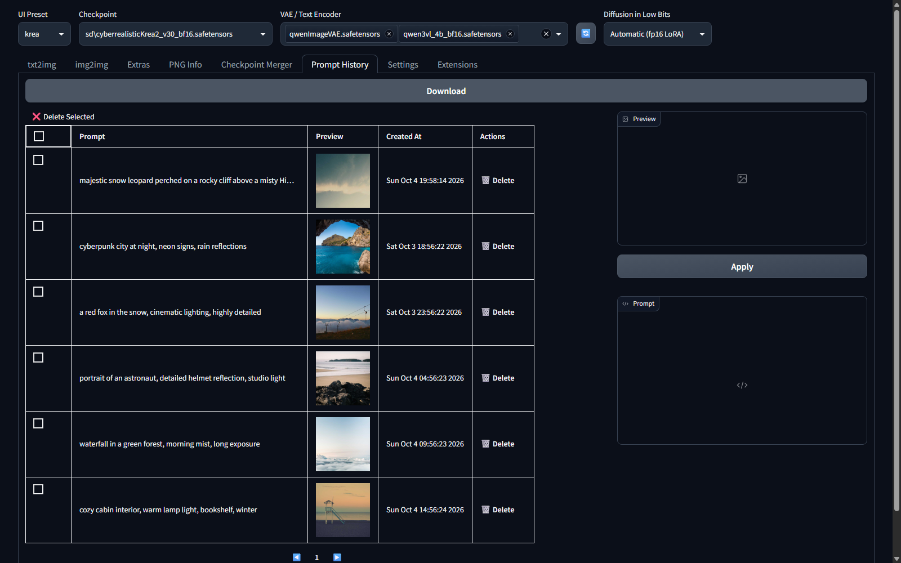

# sd-webui-prompt-history (Forge Neo fork)

> A prompt journal for **Stable Diffusion Forge Neo** — save, review and export the prompts of your generations.

This is a fork of [namkazt/sd-webui-prompt-history](https://github.com/namkazt/sd-webui-prompt-history) (thanks @namkazt for the original work!) adapted for **Stable Diffusion Forge Neo** (tested on Forge Neo `2.29.2`, branch `neo`, Gradio 4.40) and focused on one thing: **your prompts**, nothing else.

## Why this fork?

The original extension stores the full generation info (prompt + sampler, steps, seed, CFG, negative prompt...) for every generation. That is useful if you want to reproduce a generation exactly — but most of the time you only want to keep track of the *prompts* you use.

This fork:

1. **Saves prompts only on demand** — nothing is recorded automatically. A prompt is saved only when you click **"Save Last Generated Info"** (button in the *Prompt History* tab, or the matching button injected in the txt2img tab). You stay in full control of what ends up in your history.
2. **Stores the prompt only** — generation parameters (steps, sampler, seed, CFG, ...) are dropped by default. One clean line per entry. If you want to keep the parameters too (useful for reproducing a generation), enable the optional **"Also save generation parameters"** setting.
3. **Hover tooltips** — hover the prompt column in the table to read the full prompt in a tooltip (long prompts are no longer truncated). Can be disabled with the **"Show full prompt on hover in the table"** setting.
4. **Export to `.txt`** — one click on **"📄 Export prompts (.txt)"** downloads all saved prompts as a plain-text file (one block per prompt, with its date and its parameters when stored).



*The Prompt History tab: your prompt journal, with the export button on top.*



*Hover a prompt in the table to see the full text, even when it's long.*

## Features

- **Manual save** — the **"Save Last Generated Info"** button appears in the *Prompt History* tab and is also injected in the txt2img tab (next to the gallery), so you can save a prompt without leaving your workflow. The button is only enabled when a last generation exists.
- **Prompt-only storage** — each entry keeps just the prompt (first line of the generation info), a thumbnail of the generated image, and the date. No parameters, no noise.
- **Hover tooltip** — full prompt on hover, with word wrapping for long prompts.
- **Export to `.txt`** — "📄 Export prompts (.txt)" exports the whole journal to a downloadable text file.
- **Browse & manage** — thumbnail preview, pagination, click an entry to preview the image, edit the prompt, apply it back to txt2img, single or multi-select delete.



*The "Save Last Generated Info" button, injected in the txt2img tab.*



*One-click export of the whole prompt journal.*

## Requirements

- [Stable Diffusion Forge Neo](https://github.com/AUTOMATIC1111/stable-diffusion-webui-forge) (this fork targets the `neo` branch; tested on Forge Neo **2.29.2**)
- Works with txt2img (img2img info is captured the same way if you run it, but the save button is shown on the txt2img tab)

## Installation

1. Clone this repository into your Forge Neo `extensions` folder:

   ```bash
   cd <path-to-forge>/extensions
   git clone https://github.com/Simmoril-QC/sd-webui-prompt-history.git
   ```

2. Restart Forge Neo.
3. A new **"Prompt History"** tab appears in the UI (under *Extensions*).

> **Note:** after cloning, make sure *Settings → Prompt History → "Automatic Save"* is **unchecked** (it is the intended mode for this fork). If it is checked, the extension falls back to the original behavior: every generation is saved automatically.

## Usage

1. Generate an image in txt2img.
2. Click **"Save Last Generated Info"** (in the txt2img tab or in the *Prompt History* tab).
3. Your prompt appears at the top of the *Prompt History* table.
4. Hover a prompt to read the full text, click an entry to preview the image and edit/apply the prompt, or delete entries (single or multi-select).
5. Anytime, click **"📄 Export prompts (.txt)"** to download the whole journal.

## Options

Settings live in *Settings → Prompt History*:

| Option | Description |
| --- | --- |
| **Enabled** | Master switch for the extension. |
| **Data Storage Path** | Where the journal (`data.json`) and thumbnails are stored. |
| **Preview thumbnail size in table** | Size (px) of the thumbnails in the table. |
| **Number of history items display per page** | Pagination size. |
| **Automatic Save** | If *checked*, every generation is saved automatically (original behavior). If *unchecked* (recommended for this fork), prompts are saved only when you click **"Save Last Generated Info"**. |
| **Also save generation parameters** | If *checked*, the full generation info (prompt + steps, sampler, seed, CFG, ...) is stored alongside the prompt. The prompt is always saved; the parameters are optional. Entries saved with parameters include them in the export, and the preview panel shows the full info for **Apply** (paste back into txt2img with all settings). |
| **Show full prompt on hover in the table** | If *checked*, hovering a prompt in the table shows the full text in a tooltip. Uncheck to disable the hover tooltip. |
| **Save Thumbnail** | `full` (default), `thumbnail` (resized to 300px) or `none`. |

## Data format

The journal is a plain JSON file (`data.json` in the data folder):

```json
[
  {
    "id": "9f2c...",
    "name": "a red fox in the snow, cinematic",
    "model": "sd_xl_base_1.0.safetensors",
    "prompt": "a red fox in the snow, cinematic",
    "params": "a red fox in the snow, cinematic\nSteps: 28\nSampler: DPM++ 2M\nSeed: 123456\n...",
    "created_at": 1762243200.0
  }
]
```

`params` is empty unless the **"Also save generation parameters"** option is enabled. Entries saved by the original extension (with `info_text` containing the full parameters) are automatically read and reduced to their prompt only, so you can keep an existing history.

## Credits

- Based on [namkazt/sd-webui-prompt-history](https://github.com/namkazt/sd-webui-prompt-history) — original extension by [@namkazt](https://github.com/namkazt), MIT licensed.
- Adapted for Stable Diffusion Forge Neo by [Simmoril-QC](https://github.com/Simmoril-QC).

## License

[MIT](LICENSE)
